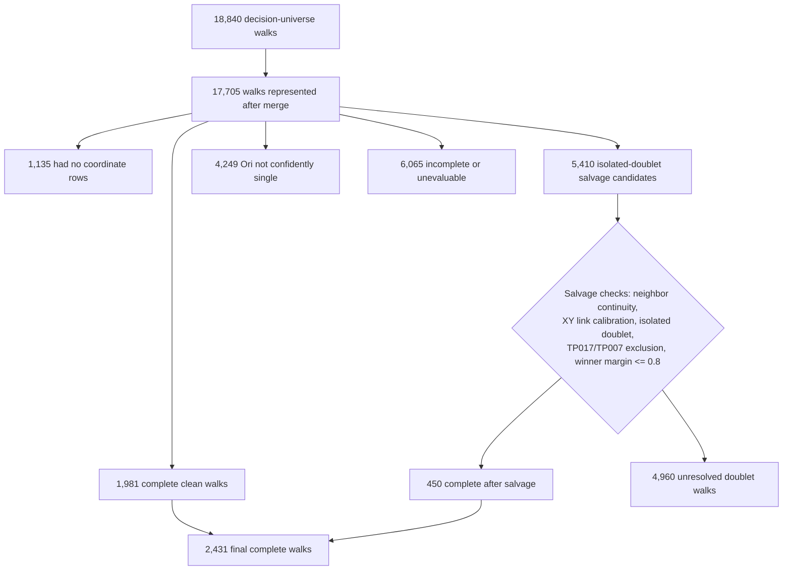
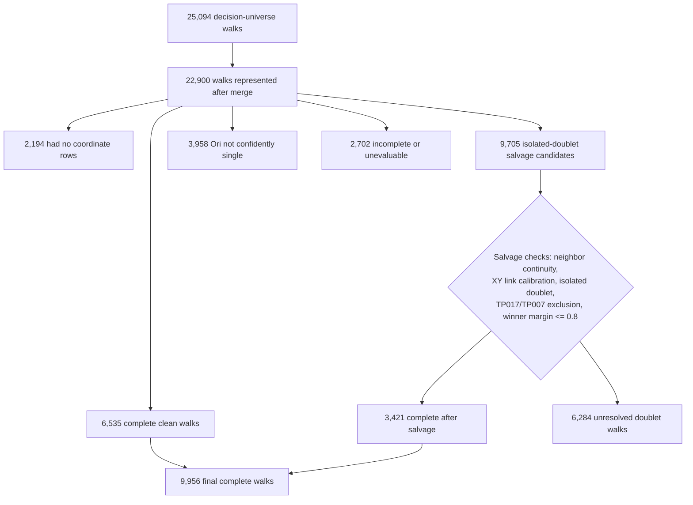

# Aug-4 trace-salvage walk flowchart

These counts are from the uploaded Aug-4 `trace_salvage_output_v2` summaries in
`dropbox:cellpose/trace_salvage/`. Counts are walks, not locus rows.

The status branches are mutually exclusive after the coordinate-coverage step;
they are not sequential filters that can be subtracted in arbitrary order.

## Replicate 1

## Replicate 3

## Final arithmetic

| Dataset | Clean | Complete after salvage | Final complete |
|---|---:|---:|---:|
| rep1 | 1,981 | 450 | **2,431** |
| rep3 | 6,535 | 3,421 | **9,956** |

The salvage policy required all of the following for a discordant locus:

- the doublet was isolated and Ori was confidently single;
- TP017 (Ori) and TP007 (Ter) were never salvaged;
- both neighboring XY links were within the location leave-one-out 95th-percentile calibration limit;
- the winning component's path was at most 0.8 times the runner-up path;
- the selected coordinate was the full drift-corrected XYZ coordinate of that component.

The manifests do not store cumulative walk counts after each individual salvage
criterion. They store the final mutually exclusive walk status, so the 450/3,421
and 4,960/6,284 values are the defensible pass/fail counts for the combined
salvage decision.
