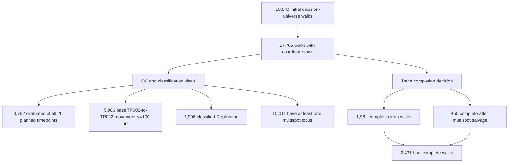

# Aug-4 trace-salvage flowchart: top-level view

This is the reader-facing version of the Aug-4 results uploaded to
`dropbox:cellpose/trace_salvage/`. All values below are **walk counts**.

Important: movement, replication, and multispot status are parallel QC views.
They are not sequential filters whose counts should be multiplied together.
The final complete-walk count is determined by the clean/salvage decision.

## Replicate 1

## Replicate 3

## What each group means

**Initial decision-universe walks**

All walks present in the configured acquisition/locus universe before requiring
usable coordinate rows.

**Coordinate-bearing walks**

Walks for which the merged localization output contains at least one usable
coordinate row. Walks with no coordinate rows cannot enter trajectory analysis.

**Complete 20-timepoint walks**

Walks with evaluated localizations at all 20 planned chromosome loci (TP002–
TP021). This is a completeness/QC measurement; it is not identical to the
final clean-walk definition.

**Movement QC**

The displacement check compares the first and last planned loci, TP002 to
TP022, using the configured XYZ movement threshold of 100 nm. It flags or
filters excessive movement; it is reported separately from trace salvage.

**Replication classification**

The replication rules use the Ori/Ter hierarchy and the per-locus two-component
evidence to label walks as replicating, non-replicating, indeterminate, or
multispot-only. A replication label is a biological classification, not a
guarantee that every locus is a clean single spot.

**Multispot group**

Any walk with at least one multispot locus. These walks are not automatically
discarded: isolated, non-Ori/non-Ter doublets can enter the neighbor-guided
salvage test.

**Complete clean walks**

All planned loci are confidently single and have finite drift-corrected XYZ
coordinates.

**Complete after multispot salvage**

A walk that would otherwise contain an isolated discordant doublet, but passes
the neighbor-continuity, XY calibration, and winner-margin checks. The selected
component is retained as the trace coordinate.

**Final complete walks**

`complete clean + complete after salvage`: 2,431 for rep1 and 9,956 for rep3.
